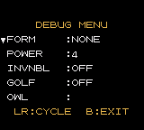

# Wario Land 3 + Debug/Cheat Menu



## What

A "Debug Menu" (more like a "Cheat Menu", really), inspired by Metroid Fusion's debug menu.

Accessible via SELECT during level play.
The menu allows cycling through:
- POWER: power-up level 0-9
- FORM: 12 transformation states (NONE/HOT/FLAT/STRNG/FAT/ELEC/PUFFY/ZOMBI/BUNCY/CRAZY/VAMPI/SNWMN)
- INVNBL: toggles invisibility on/off
- GOLF: auto-wins the current area's golf minigame. Must exit and re-enter area for it to take effect. This is currently done automatically, but it sometimes leads to soft-locking, so I'll remove it in the future, and we'll be back to having to manually exit and re-enter the area.
- OWL: spawns a sleeping owl next to Wario, in any level. It can be woken, grabbed and flown like a real owl. In rooms whose enemy set has no owl, its graphics go into a graphics slot the set doesn't use, or, if it uses all four, replace its first enemy's while it's around. Wario can fly holding it into other rooms, as with the real one. Shows NO when there's no free object slot, and in boss battles.
- TREASURE: pick any level's treasure with LEFT/RIGHT (e.g. `N5 RED`) and press A to give it to Wario or take it back. Treasures that open new paths (like N5's Foot of Stone opening a secret door in S4) take effect the next time you enter a level from the map, as in the real game.

Navigate with UP/DOWN, cycle value with LEFT/RIGHT (A toggles the selected treasure), exit with B.
The menu saves/restores level VRAM state via SaveBackupVRAM/LoadBackupVRAM, loads the font for display, and returns to the same level substate on exit.

Other features:
- Auto swim while holding down B rather than having to continuously press it
- Auto fly in vampire mode holding down B, same as autoswim
- Pressing SELECT while in a FORM will automatically turn you back into normal Wario first. Press SELECT again to open the DEBUG menu. This applies whenever you're in a non-normal form, regardless of whether you activated it via the DEBUG MENU or through normal gameplay.

New state ST_DEBUG_MENU ($0f) replaces the unused ST_UNUSED_0F slot.
All debug menu code auto-linked into bank $01 (646 bytes).

## Why

For fun! This is more a cheating menu than a debug menu, really. I played Wario Land 3 probably over 20 times, through and through. I still don't get tired of it. This is just another way to play it.

## How to Play

To assemble, download RGBDS (https://github.com/gbdev/rgbds/releases) and extract it to /usr/local/bin. Run `make` in your shell. The build output will be "warioland3.gbc".

## Tests

`tests/` drives the built ROM in [PyBoy](https://github.com/Baekalfen/PyBoy) and compares screenshots against goldens in `tests/goldens/`.

```nu
pip install -r tests/requirements.txt
make test
# after checking tests/output/*.png by eye, accept them as the new goldens:
python3 -m pytest tests --update-goldens
```

Every run writes its screenshots (and a `.diff.png` on mismatch) to `tests/output/`.

- `test_out_of_the_woods.py` plays N1 from a new game: grabs the grey key, opens the grey chest, and checks the key/treasure flags, the clear screen and the treasure count.
- `test_debug_menu.py` opens the debug menu and exercises FORM, POWER and INVNBL, checking the RAM each one changes.
- `test_steep_canyon.py` unlocks The Steep Canyon's secret door with the debug menu's TREASURE and plays to its owl room: a real owl to grab and a debug owl to spawn. With the Rust Spray, it also breaks the cracked column at the end of the start room and flies a debug owl into the room past it.
- `test_owl_cases.py` covers the debug owl around a flight: letting go, going offscreen, leaving the level while holding it, night (it takes off right away, like real owls), spawning against a wall, and filling every object slot.
- `test_owl.py` grabs the real owl in The Colossal Hole (the reference for the debug-menu owl), and spawns, grabs and flies the debug owl both there and in The Steep Canyon start room, which loads no owl graphics.
- `test_owl_levels.py` takes the debug owl to levels without owls: a handful of start rooms (Castle of Illusions among them), night, floor-by-floor cameras, water and underwater, full object slots, a boss battle (where it's refused), and saving and continuing.
- `test_owl_free_slot.py` checks where the debug owl's graphics go in rooms without an owl: an enemy graphics slot the room doesn't use (Desert Ruins' start room, next to its spearheads, which keep theirs), or slot 1 when it uses all four (Out of the Woods). It also checks the rule for an unused slot against every object group's OAM data.

The first two only press buttons; no RAM is written. Level routes live in `tests/routes/` as lists of `(buttons, frames)` steps, found with `tests/tools/route_search.py`. `tests/tools/level_map.py` prints a level as ASCII (solid blocks, ladders, doors, objects), and `tests/tools/pathfind.py` builds a movement graph from the same data and runs A* over it, through doors and pipes. The graph follows Wario's power-ups (jump height, swimming, ground pounds that turn Togebas into platforms) and the treasures held (which pick the level's variant, like the Foot of Stone opening The Steep Canyon's secret door). `route_search.py --plan LEVEL` uses its distance field as the search heuristic, which is how the whole of Out of the Woods can be found from just "key, then chest".

## Where

Tested with [gearboy](https://github.com/drhelius/Gearboy), and played through-and-through on a real Gameboy Color with an EverDrive. The game can be played completely, without issues.

### Known Bugs

- Vampire mode, while flying, doesn't properly execute screen transitions. The "camera" stays in the current screen, even though Wario correctly moves to the proper screen. Collision occurs correctly. To "fix" this, turn into non-flying Vampire mode, or normal mode, and jump. This will cause the screen to transition. Alternatively, only use fly-mode in areas that don't have screen transitions, and use "Puffy" in areas that do.
- OWL: in rooms whose camera moves a floor at a time (instead of following Wario), the owl Owl Wario holds goes above the screen near the top of a floor.
- OWL: in rooms whose enemy set has no owl and uses all four graphics slots, the debug owl's graphics replace the set's first enemy's until the room is reloaded. See `owl.md` for both, and the bug that broke the first attempt.

## How

This was entire vibe-coded. I do have 23 years of experience writing code, but I don't know ASM, and learning it to implement such features in a GB game isn't a top priority of mine. I did read parts of the implementation out of curiosity, ask Claude questions about it, made small changes to see what would happen, and read the first part of [gb-asm-tutorial](https://gbdev.io/gb-asm-tutorial/index.html) (highly recommended resource! extremely friendly — way friendlier than the usual learning resources for programming, in general).

I also did some debugging with Gearboy's debugging options.

My role as more QA than programmer. 

Here's the whole conversation with Claude that I had to make these changes: https://claude.ai/code/session_01F8cyT2Vr9JeFoMFFZrHiwx. I think there's value in it, which is why I'm sharing it publicly. Seeing what the AI did was a way of learning, to me, and might be, too, to GB development newbies.

## Origin

This is a fork of [ElectroDeoxys/warioland3](https://github.com/ElectroDeoxys/warioland3).

## Links

- [gbdev.io/gb-asm-tutorial](https://gbdev.io/gb-asm-tutorial/index.html)
- [rgbds.gbdev.io/docs](https://rgbds.gbdev.io/docs/v1.0.1)

