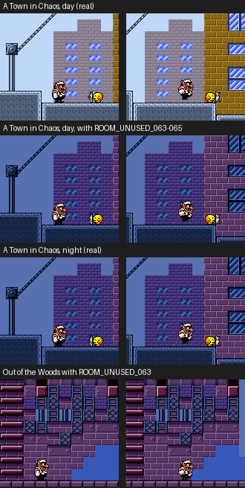

# Curiosities

Odd things found in the game's data and code while naming it. None of them
is a bug that matters in play; [Original game bugs](original-game-bugs.md)
has those.

## Three unused room sets are copies of the night town

A `ROOM_*` index is not a map: it's the set of graphics a stretch of a level
uses (blockset, block functions, main tiles, palette). The map itself
belongs to the level. Three of these sets, `ROOM_UNUSED_063`, `_064` and
`_065`, are listed in the room table but no level uses them.

They look like cut content, but they're exact copies of
`ROOM_A_TOWN_IN_CHAOS_1_NIGHT`, `_2_NIGHT` and `_3_NIGHT`: the same blocksets
and tiles, with the night palettes (`ROOM_PAL_A_TOWN_IN_CHAOS_5` to `_7`).
To check, A Town in Chaos by day was built with its three room sets swapped
for the unused ones. In the emulator it is the real night version, pixel for
pixel:

The last row puts `ROOM_UNUSED_063` on the first room of Out of the Woods:
the forest's map, drawn with the town's blocks.

## Other unused data

- `OBJECT_GROUP_UNUSED_066` is an exact copy of
  `OBJECT_GROUP_THE_VOLCANOS_BASE_1`. Three other unused object groups reuse
  the enemy lists of used groups with a different colour.
- `ROOM_PALCYCLE_UNUSED_12` to `_19` are copies of the empty palette cycle.
- `ANIMATED_TILES_GFX_MENU` is in the room animation table, but no room uses
  it: only the musical coins screen and the golf course menu load it.
- `SFX_TIPTOE_2_B_UNUSED` plays the same notes as `SFX_TIPTOE_2`, on the
  second square channel instead of the first, so it could play without
  cutting off another sound. Nothing plays it.

## Small oddities in the code

- When a coin starts moving, it goes straight to its second bounce state
  without its set-up state, so the first bounce lasts 4 frames instead of 5.
- Pillar Platform has a branch for `OBJSTATE_2B` that can never run: nothing
  ever sets that state on it.
- Yellow Belly's pump stores a state value, `OBJSTATE_RESIST_VANISH`, in
  `wYellowBellyHitRequest`, which is only ever tested for zero: the state
  doubles as a yes/no flag.
- `LoadNewestValidSave` picks the newest of the six save copies by comparing
  their 32-bit save counters one bit at a time, from the top bit. When they
  tie, it prefers them in a fixed order: game data, its backup, WRAM data,
  then backups 1 to 3.
- On page 5 of the epilogue, the old man's talking animation switches on a
  different line of text in Japanese than in English.
- Several sound effects are shared by unrelated things: the sound named
  `SFX_PESCE_3_YB_2` plays when Pesce lets Wario go in the water and when
  one of Yellow Belly's palette flashes ends.
