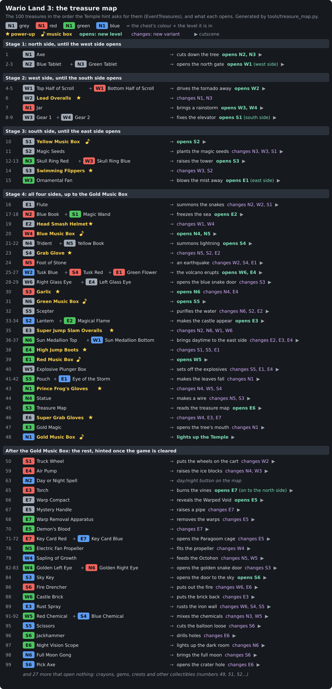

# The treasure map

Wario Land 3 has 100 treasures, four per level, one in each chest colour:
grey, red, green and blue. Some are power-ups, five are music boxes, and many
change the map when Wario brings them back: a tree is cut, a gate opens, a
new level appears, or a level he already knows gets a new route. This page
shows that chain: in which order the treasures come, and what each one opens.

Each row is one map event. The chips are the treasures it needs, in their
chest's colour, with the level they're in (N1-N6, W1-W6, S1-S6, E1-E7, in
map order on each side). Gold names are power-ups (★) and music boxes (♪).
After the arrow: what the event does on the map. **opens** means a level
that couldn't be reached before; *changes* means a level that will now load
a different variant, with new routes; *opens paths in* marks the levels a
power-up flashes on the map: the game switches them to another variant too,
but one with the same map and rooms, so nothing in the level changes; what's
new is that Wario can now take paths he couldn't before. ▶ means the event
has a cutscene.
Click the picture to open it at full size. The same data is in the tables
below.

Everything here comes out of the game's data, extracted by
`tools/treasure_map.py`, which also writes the tables on this page and the
picture. Run it again after changing any of the tables it reads;
`python3 tools/treasure_map.py --check` says whether the page is up to date.

## Where the order comes from

The order is the game's own. Standing on the Temple and pressing UP shows
the name of the level where the next treasure is
(`HandleTempleHintInput`, `GetMapSideAndLevelForNextTreasure`). That
treasure, `wNextTreasure`, is chosen by `GetNextTreasureToCollect`
(`src/engine/overworld/bank20.asm`): it finds the treasure it pointed at last
in `EventTreasures`, then walks the table forward to the first treasure not
collected yet. So `EventTreasures` lists the treasures in the intended
order. Until the game is cleared the hint stops after
`EVENT_GOLD_MUSIC_BOX` and points at the Temple instead; the treasures
after it are hinted only once `MODE_GAME_CLEARED_F` is set.

The rest of the chain:

| What | Table | File |
|---|---|---|
| treasure → event | `EventTreasures`: up to three treasures per `EVENT_*`; the event happens once all of them are collected (`CheckIfEventIsUnlocked`) | `src/engine/overworld/bank20.asm` |
| event → map | `OWSceneParams`: `UNLOCK_LEVEL` opens a path (`UnlockableConnections`), `HIGHLIGHT_LEVEL` flashes a level that changed, `DO_OW_FUNC` and `SPECIAL_ACTION` play a map animation | `src/engine/overworld/bank20.asm`, `src/data/overworld/unlockable_connections.asm` |
| map paths | `OWLevelPaths`, for the north junction between N1, N2 and N3 | `src/data/overworld/paths.asm` |
| map sides | `SetNextPrevMapButtonsSelectable.CheckAccessibleMapSides`: which event makes each side reachable | `src/engine/overworld/bank20.asm` |
| cutscenes | `CutsceneInitFunctions`: `NoInitCutscene` means none | `src/engine/overworld/cutscene/init.asm` |
| treasure → level variant | `LevelTreasureRequirements`, read by `SelectLevel` (see [Level variants](levels-and-rooms.md#level-variants)) | `src/data/levels/treasure_requirements.asm` |
| where each treasure is | `LevelTreasureIDs`: four per level, grey, red, green, blue | `src/data/levels/level_treasures.asm` |
| power-ups | `LEAD_OVERALLS` ... `SUPER_GRAB_GLOVES`, whose treasures are the same names with `_T` (`SetTreasureTransitionParam`) | `src/constants/wario_constants.asm`, `src/engine/clear/treasure_transition.asm` |

The script walks `EventTreasures` in order, collects each event's
treasures, opens the paths it unlocks and works out the variant
`SelectLevel` would now pick for every level. It checks that every
treasure's level can be reached by the time the hint asks for it (true for
all 100) and that the power-ups come in order (they do, 1 to 9).

## The order

The stages end where a new map side becomes reachable
(`CheckAccessibleMapSides`): the north gate opens the west side, the
elevator the south side, the fan the east side. A row with several
treasures is one event that needs all of them; the numbers are the hint
order.

<!-- begin: sequence -->
### Stage 1: north side, until the west side opens

| # | Treasure (level, chest) | Then |
|---|---|---|
| 1 | Axe (N1 grey) | cuts down the tree, opens N2 The Peaceful Village, N3 The Vast Plain; cutscene |
| 2-3 | Blue Tablet (N2 grey) + Green Tablet (N3 grey) | opens the north gate, opens W1 Desert Ruins (west side reachable); cutscene |

### Stage 2: west side, until the south side opens

| # | Treasure (level, chest) | Then |
|---|---|---|
| 4-5 | Top Half of Scroll (W1 grey) + Bottom Half of Scroll (W1 red) | drives the tornado away, opens W2 The Volcano's Base; cutscene |
| 6 | **Lead Overalls** (W2 grey, power-up 1) | opens paths in N1, N3 |
| 7 | Jar (N1 red) | brings a rainstorm, opens W3 The Pool of Rain, W4 A Town in Chaos; cutscene |
| 8-9 | Gear 1 (W3 grey) + Gear 2 (W4 grey) | fixes the elevator, opens S1 The Grasslands (south side reachable); cutscene |

### Stage 3: south side, until the east side opens

| # | Treasure (level, chest) | Then |
|---|---|---|
| 10 | **Yellow Music Box** (S1 grey, music box) | opens S2 The Big Bridge; cutscene |
| 11 | Magic Seeds (S2 grey) | plants the magic seeds, changes N3, W3, S1; cutscene |
| 12-13 | Skull Ring Red (N3 green) + Skull Ring Blue (W3 red) | raises the tower, opens S3 Tower of Revival; cutscene |
| 14 | **Swimming Flippers** (S3 grey, power-up 2) | opens paths in W3, S2 |
| 15 | Ornamental Fan (W3 green) | blows the mist away, opens E1 The Stagnant Swamp (east side reachable); cutscene |

### Stage 4: all four sides, up to the Gold Music Box

| # | Treasure (level, chest) | Then |
|---|---|---|
| 16 | Flute (E1 grey) | summons the snakes, changes N2, W2, S1; cutscene |
| 17-18 | Blue Book (N2 red) + Magic Wand (S1 green) | freezes the sea, opens E2 The Frigid Sea; cutscene |
| 19 | **Head Smash Helmet** (E2 grey, power-up 3) | opens paths in W1, W4 |
| 20 | **Blue Music Box** (W4 red, music box) | opens N4 Bank of the Wild River, N5 The Tidal Coast; cutscene |
| 21-22 | Trident (N4 grey) + Yellow Book (N5 grey) | summons lightning, opens S4 The Steep Canyon; cutscene |
| 23 | **Grab Glove** (S4 grey, power-up 4) | opens paths in N5, S2, E2 |
| 24 | Foot of Stone (N5 red) | an earthquake, changes W2, S4, E1; cutscene |
| 25-27 | Tusk Blue (W2 blue) + Tusk Red (S4 red) + Green Flower (E1 red) | the volcano erupts, opens W6 The West Crater, E4 The Colossal Hole; cutscene |
| 28-29 | Right Glass Eye (W6 grey) + Left Glass Eye (E4 grey) | opens the blue snake door, changes S3; cutscene |
| 30 | **Garlic** (S3 red, power-up 5) | opens N6 Sea Turtle Rocks, opens paths in N4, E4 |
| 31 | **Green Music Box** (N6 grey, music box) | opens S5 Cave of Flames; cutscene |
| 32 | Scepter (S5 grey) | purifies the water, changes N6, S2, E2; cutscene |
| 33-34 | Lantern (S2 blue) + Magical Flame (E2 green) | makes the castle appear, opens E3 Castle of Illusions; cutscene |
| 35 | **Super Jump Slam Overalls** (E3 grey, power-up 6) | opens paths in N2, N6, W1, W6 |
| 36-37 | Sun Medallion Top (N6 green) + Sun Medallion Bottom (W1 blue) | brings daytime to the east side, changes E2, E3, E4; cutscene |
| 38 | **High Jump Boots** (E4 green, power-up 7) | opens paths in S1, S5, E1 |
| 39 | **Red Music Box** (E1 green, music box) | opens W5 Beneath the Waves; cutscene |
| 40 | Explosive Plunger Box (W5 grey) | sets off the explosives, changes S5, E1, E4; cutscene |
| 41-42 | Pouch (S5 green) + Eye of the Storm (E1 blue) | makes the leaves fall, changes N1; cutscene |
| 43 | **Prince Frog's Gloves** (N1 green, power-up 8) | opens paths in N4, W5, S4 |
| 44 | Statue (N4 green) | makes a wire, changes N5, S3; cutscene |
| 45 | Treasure Map (S3 green) | reads the treasure map, opens E6 The East Crater; cutscene |
| 46 | **Super Grab Gloves** (E6 grey, power-up 9) | opens paths in W4, E3, E7 |
| 47 | Gold Magic (E3 green) | opens the tree's mouth, changes N1; cutscene |
| 48 | **Gold Music Box** (N1 blue, music box) | lights up the Temple; cutscene |
<!-- end: sequence -->

The Gold Music Box is the last of the five music boxes and the end of the
hinted path. Its scene lights up the Temple, and entering the Temple with it
plays `TEMPLE_SCENE_HIDDEN_FIGURE_REVEAL` instead of the usual
`TEMPLE_SCENE_ENTERING` (`src/engine/overworld/bank2b_1.asm`).

## After the Gold Music Box

The other 52 treasures are hinted only after the game is cleared, but
nothing stops Wario from getting them before. Some still open things,
among them a whole level each (Forest of Fear, The Warped Void, Above the
Clouds); most open nothing on the map.

<!-- begin: after -->
| # | Treasure (level, chest) | Then |
|---|---|---|
| 49 | Blue Crayon (N3 red) | opens nothing |
| 50 | Truck Wheel (S1 red) | puts the wheels on the cart, changes W2; cutscene |
| 51 | Blue Gem (W2 red) | opens nothing |
| 52 | Cyan Crayon (S2 red) | opens nothing |
| 53 | Goblet (N2 green) | opens nothing |
| 54 | Crown (W2 green) | opens nothing |
| 55 | Pink Crayon (W1 green) | opens nothing |
| 56 | Teapot (E2 red) | opens nothing |
| 57 | Pocket Pet (S2 green) | opens nothing |
| 58 | Magnifying Glass (N4 red) | opens nothing |
| 59 | Air Pump (E4 red) | raises the ice blocks, changes N4, W3; cutscene |
| 60 | Rocket (N4 blue) | opens nothing |
| 61 | Yellow Crayon (W3 blue) | opens nothing |
| 62 | Saber (W6 red) | opens nothing |
| 63 | Day or Night Spell (N2 blue) | day/night button on the map |
| 64 | UFO (E2 blue) | opens nothing |
| 65 | Torch (E3 red) | burns the vines, opens E7 Forest of Fear (on to the north side); cutscene |
| 66 | Warp Compact (E7 grey) | reveals the Warped Void, opens E5 The Warped Void; cutscene |
| 67 | Mystery Handle (E5 grey) | raises a pipe, changes E7; cutscene |
| 68 | Warp Removal Apparatus (E7 green) | removes the warps, changes E5; cutscene |
| 69 | Brown Crayon (E5 red) | opens nothing |
| 70 | Demon's Blood (E5 green) | changes E7; cutscene |
| 71-72 | Key Card Red (E7 red) + Key Card Blue (E7 blue) | opens the Paragoom cage, changes E5; cutscene |
| 73 | Heart Crest (E5 blue) | opens nothing |
| 74 | Minicar (S5 red) | opens nothing |
| 75 | Locomotive (E4 blue) | opens nothing |
| 76 | Telephone (S4 green) | opens nothing |
| 77 | Red Crayon (W5 red) | opens nothing |
| 78 | Electric Fan Propeller (N5 green) | fits the propeller, changes W4; cutscene |
| 79 | Sapling of Growth (W4 blue) | feeds the Octohon, changes N5, W5; cutscene |
| 80 | Green Gem (N5 blue) | opens nothing |
| 81 | Fighter Mannequin (S1 blue) | opens nothing |
| 82-83 | Golden Left Eye (W4 green) + Golden Right Eye (N6 red) | opens the golden snake door, changes S3; cutscene |
| 84 | Sky Key (S3 blue) | opens the door to the sky, opens S6 Above the Clouds; cutscene |
| 85 | Green Crayon (S6 grey) | opens nothing |
| 86 | Fire Drencher (S6 red) | puts out the fire, changes W6, E6; cutscene |
| 87 | Diamonds Crest (E6 red) | opens nothing |
| 88 | Castle Brick (W6 green) | puts the brick back, changes E3; cutscene |
| 89 | Rust Spray (E3 blue) | rusts the iron wall, changes W6, S4, S5; cutscene |
| 90 | Spades Crest (W6 blue) | opens nothing |
| 91-92 | Red Chemical (W5 green) + Blue Chemical (S4 blue) | mixes the chemicals, changes N3, W5; cutscene |
| 93 | Red Gem (N3 blue) | opens nothing |
| 94 | Clubs Crest (W5 blue) | opens nothing |
| 95 | Scissors (S5 blue) | cuts the balloon loose, changes S6; cutscene |
| 96 | Jackhammer (S6 green) | drills holes, changes E6; cutscene |
| 97 | Night Vision Scope (E6 green) | lights up the dark room, changes N6; cutscene |
| 98 | Full Moon Gong (N6 blue) | brings the full moon, changes S6; cutscene |
| 99 | Pick Axe (S6 blue) | opens the crater hole, changes E6; cutscene |
| 100 | Earthen Figure (E6 blue) | opens nothing |
<!-- end: after -->

## Levels and their chests

Each level's four chests, with their number in the order above, the
treasures that open the level, and the ones that switch on its variants
(`SelectLevel` picks the highest variant whose treasures are all held).

<!-- begin: levels -->
| Level | Opened by | Grey | Red | Green | Blue | Variant 2 / 3 / 4 needs |
|---|---|---|---|---|---|---|
| N1 Out of the Woods | the start | 1 Axe | 7 Jar | 43 Prince Frog's Gloves (power-up 8) | 48 Gold Music Box (music box) | Lead Overalls / Pouch + Eye of the Storm / Gold Magic |
| N2 The Peaceful Village | Axe (1) | 2 Blue Tablet | 17 Blue Book | 53 Goblet | 63 Day or Night Spell | Flute / Flute / Super Jump Slam Overalls (variant 2 never picked in this order) |
| N3 The Vast Plain | Axe (1) | 3 Green Tablet | 49 Blue Crayon | 12 Skull Ring Red | 93 Red Gem | Lead Overalls / Magic Seeds / Blue Chemical + Red Chemical |
| N4 Bank of the Wild River | Blue Music Box (20) | 21 Trident | 58 Magnifying Glass | 44 Statue | 60 Rocket | Garlic / Prince Frog's Gloves / Air Pump |
| N5 The Tidal Coast | Blue Music Box (20) | 22 Yellow Book | 24 Foot of Stone | 78 Electric Fan Propeller | 80 Green Gem | Grab Glove / Statue / Sapling of Growth |
| N6 Sea Turtle Rocks | Garlic (30) | 31 Green Music Box (music box) | 83 Golden Right Eye | 36 Sun Medallion Top | 98 Full Moon Gong | Scepter / Super Jump Slam Overalls / Night Vision Scope |
| W1 Desert Ruins | Blue Tablet (2) + Green Tablet (3) | 4 Top Half of Scroll | 5 Bottom Half of Scroll | 55 Pink Crayon | 37 Sun Medallion Bottom | Blue Tablet + Green Tablet / Head Smash Helmet / Super Jump Slam Overalls |
| W2 The Volcano's Base | Top Half of Scroll (4) + Bottom Half of Scroll (5) | 6 Lead Overalls (power-up 1) | 51 Blue Gem | 54 Crown | 25 Tusk Blue | Truck Wheel / Flute / Foot of Stone (variant 2 never picked in this order) |
| W3 The Pool of Rain | Jar (7) | 8 Gear 1 | 13 Skull Ring Blue | 15 Ornamental Fan | 61 Yellow Crayon | Magic Seeds / Swimming Flippers / Air Pump |
| W4 A Town in Chaos | Jar (7) | 9 Gear 2 | 20 Blue Music Box (music box) | 82 Golden Left Eye | 79 Sapling of Growth | Head Smash Helmet / Super Grab Gloves / Electric Fan Propeller |
| W5 Beneath the Waves | Red Music Box (39) | 40 Explosive Plunger Box | 77 Red Crayon | 91 Red Chemical | 94 Clubs Crest | Prince Frog's Gloves / Sapling of Growth / Blue Chemical + Red Chemical |
| W6 The West Crater | Tusk Blue (25) + Tusk Red (26) + Green Flower (27) | 28 Right Glass Eye | 62 Saber | 88 Castle Brick | 90 Spades Crest | Super Jump Slam Overalls / Fire Drencher / Rust Spray |
| S1 The Grasslands | Gear 1 (8) + Gear 2 (9) | 10 Yellow Music Box (music box) | 50 Truck Wheel | 18 Magic Wand | 81 Fighter Mannequin | Magic Seeds / Flute / High Jump Boots |
| S2 The Big Bridge | Yellow Music Box (10) | 11 Magic Seeds | 52 Cyan Crayon | 57 Pocket Pet | 33 Lantern | Swimming Flippers / Grab Glove / Scepter |
| S3 Tower of Revival | Skull Ring Red (12) + Skull Ring Blue (13) | 14 Swimming Flippers (power-up 2) | 30 Garlic (power-up 5) | 45 Treasure Map | 84 Sky Key | Right Glass Eye + Left Glass Eye / Statue / Golden Left Eye + Golden Right Eye |
| S4 The Steep Canyon | Trident (21) + Yellow Book (22) | 23 Grab Glove (power-up 4) | 26 Tusk Red | 76 Telephone | 92 Blue Chemical | Foot of Stone / Prince Frog's Gloves / Rust Spray |
| S5 Cave of Flames | Green Music Box (31) | 32 Scepter | 74 Minicar | 41 Pouch | 95 Scissors | High Jump Boots / Explosive Plunger Box / Rust Spray |
| S6 Above the Clouds | Sky Key (84) | 85 Green Crayon | 86 Fire Drencher | 96 Jackhammer | 99 Pick Axe | Sky Key / Scissors / Full Moon Gong |
| E1 The Stagnant Swamp | Ornamental Fan (15) | 16 Flute | 27 Green Flower | 39 Red Music Box (music box) | 42 Eye of the Storm | Foot of Stone / High Jump Boots / Explosive Plunger Box |
| E2 The Frigid Sea | Blue Book (17) + Magic Wand (18) | 19 Head Smash Helmet (power-up 3) | 56 Teapot | 34 Magical Flame | 64 UFO | Grab Glove / Scepter / Sun Medallion Top + Sun Medallion Bottom |
| E3 Castle of Illusions | Lantern (33) + Magical Flame (34) | 35 Super Jump Slam Overalls (power-up 6) | 65 Torch | 47 Gold Magic | 89 Rust Spray | Sun Medallion Top + Sun Medallion Bottom / Super Grab Gloves / Castle Brick |
| E4 The Colossal Hole | Tusk Blue (25) + Tusk Red (26) + Green Flower (27) | 29 Left Glass Eye | 59 Air Pump | 38 High Jump Boots (power-up 7) | 75 Locomotive | Garlic / Sun Medallion Top + Sun Medallion Bottom / Explosive Plunger Box |
| E5 The Warped Void | Warp Compact (66) | 67 Mystery Handle | 69 Brown Crayon | 70 Demon's Blood | 73 Heart Crest | Warp Removal Apparatus / Warp Removal Apparatus / Key Card Red + Key Card Blue (variant 2 never picked in this order) |
| E6 The East Crater | Treasure Map (45) | 46 Super Grab Gloves (power-up 9) | 87 Diamonds Crest | 97 Night Vision Scope | 100 Earthen Figure | Fire Drencher / Jackhammer / Pick Axe |
| E7 Forest of Fear | Torch (65) | 66 Warp Compact | 71 Key Card Red | 68 Warp Removal Apparatus | 72 Key Card Blue | Super Grab Gloves / Mystery Handle / Demon's Blood |
<!-- end: levels -->

## Day and night

The map, not the treasure, decides the time of day; see
[Day and night](levels-and-rooms.md#day-and-night). Two treasures change
that:

- The east side is always night until the Sun Medallion halves are
  collected: `InitEastMapSide` sets night unless `EVENT_SUMMON_SUN` is
  done, and `DoDayNightSpell` won't switch it there either.
- The Day or Night Spell puts the day/night button on the map's top bar
  (`SetDayNightSpellSelectable`). It's number 63, after the Gold Music Box.

## What the data doesn't say

- **What a chest needs inside its level.** The tables say which level a
  treasure is in and which treasures change that level, not which power-up,
  variant or time of day a particular chest or key needs. That's level
  layout. The variants don't add or remove chests: the 200 variants use 34
  block and object maps (`LevelBlockAndObjectMaps`), and a level's chests
  and keys sit in the same places in all of its maps. What changes is the
  rooms around them. A chest's colour isn't in the map either: it comes
  from the object group of the room it's in (`CommonObjects_Grey`...).
  The path finder in `tests/tools/pathfind.py`
  was tried for this: it models jumps, swimming and Togeba platforms by
  power-up level, but treats every block that needs a power-up as solid
  and knows nothing of enemies Wario has to use, so it reaches the key and
  chest of only a handful of colours, the same with no power-ups as with
  all of them. It can't tell what a chest needs; an emulator run can.
- **Whether other orders work.** The hint order is the route the game
  points at, and the script checks it against the map. Whether a treasure
  can be taken earlier depends on the same level layout facts as above.
- **Event words.** The captions ("cuts down the tree", "rusts the iron
  wall") are the event's constant read in plain words, not game text.

## Notes found on the way

- Every level the map flashes after an event (`HIGHLIGHT_LEVEL`) is a level
  whose variant that event switches on, with one exception: the Truck
  Wheel flashes The Volcano's Base, but works through the cart itself
  (`CartVariableFunc` checks `TRUCK_WHEEL` and only then lets the cart
  run). The events that change levels without flashing them play a map
  animation over them instead (the magic seeds, the snakes, the
  earthquake, the explosives, the falling leaves, the pipe), and Desert
  Ruins and Above the Clouds open straight into the variant the opening
  treasures select.
- Three variants never load in the hint order. The Peaceful Village and
  The Warped Void ask for the same treasure for variants 2 and 3 (the
  Flute, the Warp Removal Apparatus); `SelectLevel` tries 3 first, so 2 is
  never picked in any order, and both pairs share their room headers
  anyway (`ThePeacefulVillageDay2To4RoomHeaders`,
  `TheWarpedVoid2To3RoomHeaders`). The Volcano's Base variant 2 needs the
  Truck Wheel, which the hint puts after the Flute and the Foot of Stone
  that select variants 3 and 4; its room headers are variant 1's
  (`TheVolcanosBaseDay1To2RoomHeaders`).
- The hint never goes back. It searches forward from the treasure it last
  pointed at, so a treasure skipped earlier in the table won't be hinted
  again; at the end of the table it points at the Temple.
- Two scenes name a connection with another side's constant:
  `EVENT_VOLCANO_ERUPTION` unlocks `EAST, SOUTHCONN_3` and
  `EVENT_REVEAL_WARPED_VOID` `EAST, SOUTHCONN_4`. The numbers are what
  count, so they are `EASTCONN_3` (The Frigid Sea to The Colossal Hole) and
  `EASTCONN_4` (Forest of Fear to The Warped Void). `EVENT_TORCH_FOREST`
  writes its third connection as `$08`, which is `NORTHCONN_8`.
- `SetTreasureTransitionParam` sets `wPowerUpLevel` to the new power-up's
  level, it doesn't keep the higher one. The hint order gives the nine
  power-ups in order, 1 to 9, so following it the level only goes up.
